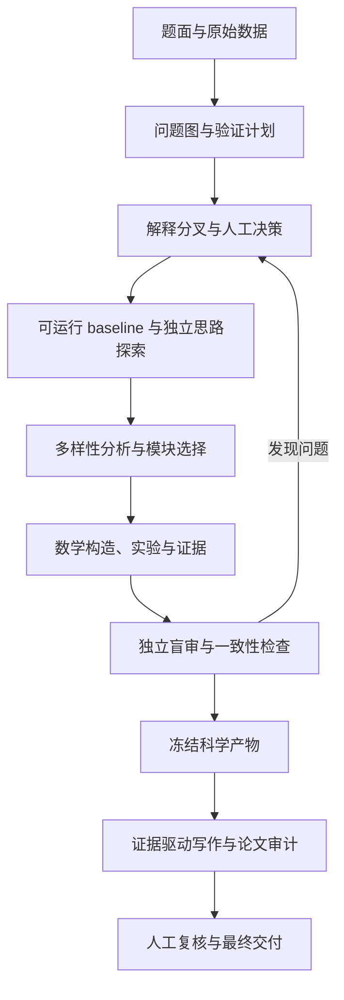

# CUMCM Adaptive Research Harness

**从题意分叉到可复算论文：面向数学建模竞赛的多 Agent 研究工作流。**

[English](README_EN.md) · [快速上手](QUICKSTART_V5.1_WINDOWS.md) · [完整指南](GUIDE_V5.1.md) · [贡献指南](CONTRIBUTING.md)

[](https://github.com/nzghd/CUMCM-Adaptive-Research-Harness/actions/workflows/ci.yml)
[](LICENSE)
[](requirements-core.txt)

这个 Harness 帮助队员与 AI 一起拆解问题、探索模型、执行实验、核对证据和撰写论文。它把研究过程保存在可检查的文件中，让每个关键结论都能追溯到假设、公式、代码和证据。

项目适用于全国大学生数学建模竞赛（CUMCM）演练，也可作为其他数学建模项目的研究流程模板。当前版本为 **5.1.0**，主要使用与验证环境为 **Windows / PowerShell**。

这是独立社区项目，与竞赛主办方无隶属关系。它不保证模型正确或竞赛获奖；人工判断、复算与当年规则核验始终是流程的一部分。

## 为什么使用它

多 Agent 可能使用不同算法，却共同误解同一个目标。实验可以跑通，论文中的“最优”“上界”“证明”却未必有依据。这个项目把这些问题变成明确的检查点：

| 研究中的问题 | Harness 提供的机制 |
| --- | --- |
| 过早锁定一种题意 | 解释分叉、假设指纹与结构敏感性检查 |
| 多个 Agent 重复探索 | Idea Card、多样性分析与按模块分配任务 |
| 公式、实现与结论脱节 | 数学模块、公式—代码映射与 Claim–Evidence Ledger |
| 跑出数值就声称严格最优 | 数学义务登记与强主张来源审计 |
| 同一上下文自审遗漏问题 | 导出清洗后的独立盲审包 |
| 论文改了却沿用旧审计 | 冻结清单、文件哈希与过期审批检查 |
| 交付物缺少可追溯记录 | 实验回执、来源登记、AI 使用日志与支撑材料打包 |

Agent 数量按问题结构与审核能力调整。多数投票和跨模型一致都不能代替数学证据。

## 工作流



G0–G7 是统一的生命周期检查点（Gate）。审批绑定当前文件与校验器的哈希；相关输入变化后，需要重新验证与审批。空模板不会被当成已完成的研究。

## 快速开始

### 1. 获取项目并安装依赖

需要 Git、Python **3.10 或更新版本**。以下命令在 PowerShell 中执行：

```powershell
git clone https://github.com/nzghd/CUMCM-Adaptive-Research-Harness.git
cd CUMCM-Adaptive-Research-Harness
python -m venv .venv
.\.venv\Scripts\python.exe -m pip install -r requirements-core.txt
```

核心工作流主要使用 Python 标准库；最终 PDF 的结构检查需要 `pypdf`。安装依赖需要联网，下面的自检和初始化不调用模型服务。

使用已有 Conda 环境也可以，先激活环境，再把下文的 `.\.venv\Scripts\python.exe` 替换为 `python`。

### 2. 检查安装

```powershell
.\.venv\Scripts\python.exe -B tools/runtime.py check
.\.venv\Scripts\python.exe -B tools/schema_validate.py --static
```

需要完整离线回归时运行：

```powershell
.\scripts\check_release.ps1 -PythonExe "$PWD\.venv\Scripts\python.exe"
```

这些检查验证软件契约与回归行为，不构成对某个竞赛模型的科学验证。

### 3. 初始化演练

把你有权使用的题面和附件分别放进 `inputs/problem/` 与 `inputs/data/`。初始化后将原始输入视为只读。

```powershell
.\.venv\Scripts\python.exe tools/harness.py init `
  --contest CUMCM-PRACTICE `
  --problem A `
  --phase rehearsal `
  --runtime codex `
  --time-budget-hours 72 `
  --human-review-hours 18 `
  --max-exploration-batches 3 `
  --max-agent-threads 4

.\.venv\Scripts\python.exe tools/harness.py status
.\.venv\Scripts\python.exe tools/harness.py next
```

命令创建 `runs/<RUN_ID>/`，包含问题图、实验、证据、审查和论文工作区。初始化只建立结构；研究内容仍需由队员与 Agent 完成。原始输入文件、生成的 runs 和本地密钥默认被 Git 忽略。

### 4. 开始研究与人工审核

在支持的 coding-agent 运行时中打开项目，按 [快速上手](QUICKSTART_V5.1_WINDOWS.md) 完成问题图、题意解释分叉与验证计划。Codex 读取 `AGENTS.md`；Claude Code 读取 `CLAUDE.md`。

每个 Gate 都先生成审核摘要，由具体队员阅读后再批准：

```powershell
.\.venv\Scripts\python.exe tools/harness.py review --gate G0
# 打开并阅读 runs/<RUN_ID>/reviews/gates/G0_REVIEW.md，处理未完成事项。
# 满足 Gate 条件后，由实际审核的队员运行（替换姓名）：
.\.venv\Scripts\python.exe tools/harness.py approve --gate G0 --by "你的姓名"
```

新建的空 run 不能直接通过 G0。详细的 stage 顺序、审批要求和论文管线见 [完整指南](GUIDE_V5.1.md)。

## 运行时与可选功能

| 运行时 / 功能 | 用途 | 入口 |
| --- | --- | --- |
| Codex | 原生 coding-agent 研究与执行 | `AGENTS.md`、`.codex/`、`.agents/skills/` |
| Claude Code | 同一研究协议的另一运行时 | `CLAUDE.md`、`.claude/` |
| Claude Code + DeepSeek | 可选兼容后端 | [运行时指南](docs/RUNTIMES.md) |
| Direct API | 对显式文件包执行有界角色调用 | [API 指南](docs/API_OPTIONAL.md) |
| Mathematical Workbench | 可选符号、量纲和优化检查 | [数学建模指南](docs/V5_MATHEMATICAL_MODELING_ENGINE.md)、`requirements-math.txt` |
| Reference Verifier | Faithful 适配器与明确区分的 Lite 流程 | [Verifier 指南](docs/REFERENCE_VERIFIER.md) |

这些运行时和服务需要自行安装或配置。API 调用默认关闭，使用前必须配置预算、显式确认并记录 AI 使用；它们可能产生独立费用。提供方模型名保存在配置文件中，应按自己账户的实际可用模型核对。

Faithful Verifier 需要 token-level logprobs；Pro-only Lite 不是官方方法的忠实实现，其分数不能解释为正确率。外部订阅网页对话由队员人工开启与导入。

## 项目结构

```text
config/          角色、预算、运行时与科学检查规则的单一事实源
skills/          canonical 研究与论文技能
tools/           CLI、校验器、实验记录与回归测试
schemas/         JSON / CSV 产物契约
templates/       run、数学模块、论文和审核模板
prompts/         各研究阶段的任务提示
method_packs/    可选方法族参考
examples/        数学工作台的小型示例
docs/            架构、方法、约束与设计决策
inputs/          本地原始题面与附件（数据默认不提交）
runs/            本地演练和竞赛工作区（默认不提交）
```

`.codex/agents/`、`.claude/agents/` 与运行时技能镜像由 `tools/runtime.py` 生成。修改角色应从 `config/agent_roles.json` 开始，修改技能应从 `skills/` 开始。

## 文档导航

| 我想…… | 阅读 |
| --- | --- |
| 第一次运行 | [Windows 快速上手](QUICKSTART_V5.1_WINDOWS.md) |
| 了解完整 v5.1 行为 | [完整指南](GUIDE_V5.1.md)、[架构](docs/ARCHITECTURE.md)、[术语](CONTEXT.md) |
| 处理题意歧义 | [解释与假设](docs/V5_1_INTERPRETATION_AND_ASSUMPTIONS.md) |
| 建立数学模块 | [数学建模引擎](docs/V5_MATHEMATICAL_MODELING_ENGINE.md) |
| 设计实验与证据 | [证据引擎](docs/EVIDENCE_ENGINE.md) |
| 组织盲审与核对主张 | [盲审与强主张](docs/V5_1_BLIND_REVIEW_AND_CLAIMS.md)、[一致性](docs/V5_1_CONSISTENCY.md) |
| 从冻结结果写论文 | [论文写作](docs/PAPER_WRITING.md) |
| 查命令 / 升级旧 run | [命令索引](tools/README.md)、[迁移指南](MIGRATION_V5_TO_V5.1.md) |
| 理解验证边界 | [已知限制](docs/LIMITATIONS.md)、[历史测试报告](TEST_REPORT_V5.1.md) |

## 贡献、规则与许可证

欢迎通过 [Issues](https://github.com/nzghd/CUMCM-Adaptive-Research-Harness/issues) 提交可复现问题，或通过 Pull Request 改进实现、文档与示例。开始前请阅读 [CONTRIBUTING.md](CONTRIBUTING.md)。安全问题请按 [SECURITY.md](SECURITY.md) 私下报告。

比赛期间遵守当年官方规则与学校要求：不搜索、发布或讨论当届赛题的现成解答；规范登记外部来源与 AI 使用。仓库中的年份配置和交付检查不能代替队员对当年正式通知的核验。

代码与文档采用 [MIT License](LICENSE)。第三方适配来源见 [THIRD_PARTY_NOTICES.md](THIRD_PARTY_NOTICES.md)；自行添加的数据和题面不自动获得本仓库许可证。
